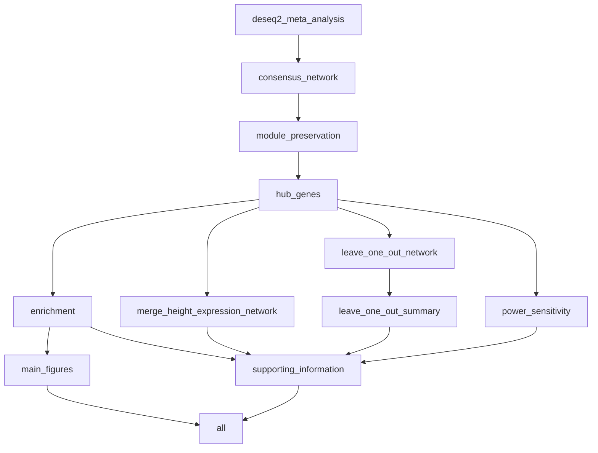

# Consensus WGCNA of bovine mastitis

[Snakemake](https://snakemake.readthedocs.io/) pipeline for the analyses described in *Integrated transcriptomic meta-analysis and consensus co-expression
networks reveal reproducible immune gene modules and candidate master regulators in bovine mastitis*.
The pipeline reproduces all analysis steps described in the manuscript.

## Input

The input files are provided in the [`data/`](data/) directory.
The gene counts were produced with [nf-core/rnaseq 3.20.0](https://nf-co.re/rnaseq/3.20.0/) from the BioProjects
[PRJNA304027](https://www.ncbi.nlm.nih.gov/bioproject/PRJNA304027) (*E. coli*), [PRJNA878880](https://www.ncbi.nlm.nih.gov/bioproject/PRJNA878880) (*S. aureus*) and [PRJNA544129](https://www.ncbi.nlm.nih.gov/bioproject/PRJNA544129) (natural mastitis).
All steps use [Ensembl release 110](https://ftp.ensembl.org/pub/release-110/) with the bovine genome assembly ARS-UCD1.2: the read alignment and quantification (genome and annotation `Bos_taurus.ARS-UCD1.2.110`) as well as the enrichment analysis.

| File | Content |
|---|---|
| [`data/counts/*_salmon.merged.gene_counts.tsv.gz`](data/counts/) | Gene counts files per dataset |
| [`data/sample_info.csv`](data/sample_info.csv) | Condition and covariates per sample |
| [`data/module_colour_reference.csv`](data/module_colour_reference.csv) | Module colors of the earlier network, used only to give modules stable color names |

All settings (DESeq2 designs, thresholds, permutations, powers, threads per rule) are in [`config/config.yaml`](config/config.yaml).

## Requirements

Only [conda](https://docs.conda.io/projects/conda/en/latest/user-guide/install/index.html) is required to run the pipeline on Linux (x86-64).
All dependencies are built within a conda environment with pinned versions (see [`workflow/envs/`](workflow/envs/)):

- R 4.6.1 with [DESeq2](https://bioconductor.org/packages/DESeq2/) 1.52.0, [WGCNA](https://cran.r-project.org/package=WGCNA) 1.74, [metafor](https://cran.r-project.org/package=metafor) 5.2-1 and [gprofiler2](https://cran.r-project.org/package=gprofiler2) 0.2.4
- all other R packages from a dated CRAN snapshot ([Posit Package Manager](https://packagemanager.posit.co/), 2026-11-16) and [Bioconductor 3.23](https://bioconductor.org/)
- the fonts used in the figures (Nimbus Sans, DejaVu Sans), so the figures do not depend on the fonts installed on the host

On the first run, Snakemake builds this environment and compiles all R packages from source, which takes about 30 minutes.

Internet access is required:

- to build the environment: conda-forge, packagemanager.posit.co, bioconductor.org and github.com (fonts)
- for the enrichment step: the [g:Profiler archive](https://biit.cs.ut.ee/gprofiler_archive3/e110_eg57_p18) (biit.cs.ut.ee), pinned to Ensembl 110 via `gprofiler_url` in the config.

## Run

Create the conda environment with snakemake from [`environment.yaml`](environment.yaml):

```bash
conda env create -f environment.yaml
conda activate smk-wgcna
conda config --set channel_priority strict
```

Afterward, the pipeline can be run with `snakemake`:

```bash
snakemake --cores 16
```

The default profile in [`workflow/profiles/default`](workflow/profiles/default/config.yaml) is loaded automatically and enables the conda environment, so no further options are needed.
Depending on the number of cores chosen, the analysis will likely finish within two hours (after the environment is built).
Most of the work can be run in parallel, but the module preservation (1,000 permutations per reference dataset) is the slowest step and will take time.

## Workflow

The rules are defined in [`workflow/Snakefile`](workflow/Snakefile). The rule graph below is the output of `snakemake --rulegraph mermaid-js` (see the Snakefile for full information):



The scripts are in [`workflow/scripts/`](workflow/scripts/):

| Script | Analysis | Manuscript |
|---|---|---|
| [`functions.R`](workflow/scripts/functions.R) | Shared analysis functions | |
| [`plot_functions.R`](workflow/scripts/plot_functions.R) | Shared plotting functions | |
| [`01_deseq2_meta_analysis.R`](workflow/scripts/01_deseq2_meta_analysis.R) | DESeq2 per dataset, Stouffer and Fisher meta-analysis | S1, S2 Tables |
| [`02_consensus_network.R`](workflow/scripts/02_consensus_network.R) | VST, soft-threshold power, consensus network, module-trait association | Fig 2, Fig 3, S3-S5 Tables, S4-S5 Figs |
| [`03_module_preservation.R`](workflow/scripts/03_module_preservation.R) | Module preservation, one job per reference dataset | S1-S3 Figs, S6 Table |
| [`04a_hub_genes.R`](workflow/scripts/04a_hub_genes.R) | Module selection, MM/GS, hub genes | Fig 4, S6-S7 Tables, S7 Fig, S11 Fig |
| [`04b_enrichment.R`](workflow/scripts/04b_enrichment.R) | GO/KEGG enrichment (g:Profiler) | Fig 4, S8 Table, S8 Fig, S11 Fig |
| [`05_merge_height_expression_network.R`](workflow/scripts/05_merge_height_expression_network.R) | Merging threshold sensitivity, network without meta-analysis preselection | S6 Fig, S9 Fig, S10 Table |
| [`06a_leave_one_out_network.R`](workflow/scripts/06a_leave_one_out_network.R) | Leave-one-dataset-out network, one job per left-out dataset | S10 Fig, S5 and S10 Tables |
| [`06b_power_sensitivity.R`](workflow/scripts/06b_power_sensitivity.R) | Alternative soft-thresholding powers | S10 Table |
| [`06c_leave_one_out_summary.R`](workflow/scripts/06c_leave_one_out_summary.R) | Summary of the leave-one-dataset-out networks | S10 Fig, S5 and S10 Tables |
| [`07_main_figures.R`](workflow/scripts/07_main_figures.R) | Main figures | Fig 1-4 |
| [`08_supporting_information.R`](workflow/scripts/08_supporting_information.R) | Supporting figures and tables | S1-S11 Figs, S1-S8, S10, S11 Tables |

S11 Table (software versions) is written from `upstream_software` in the config and the versions of the R session.

## Output

The outputs can be found in the `results` directory:

- `results/figures/` Fig 1-4 (PDF and JPG) of the manuscript
- `results/supporting_information/` S1-S11 Figs (PDF) and S1-S8, S10, S11 Tables (XLSX)
- `results/tables/` all intermediate tables (CSV)

The log of each step is written to `logs/`.

The results can differ slightly from the published tables in the manuscript.
The random steps (permutation tests, module preservation) use the fixed `seed` from the config and are reproducible,
but floating-point results depend on the numerical libraries (e.g. BLAS) of the system.
The consensus network, the module selection and the hub genes should be exactly the same as in the manuscript.

The master-regulator analysis (Fig 5, S9 Table, S12 Fig) was done on the [geneXplain/TRANSPATH](https://genexplain.com/) platform.
Its input, the Black-module hub genes, is written to `results/tables/geneXplain_input_black_hub_genes.csv`.

## License

This project is licensed under the MIT License, see [LICENSE](LICENSE).
